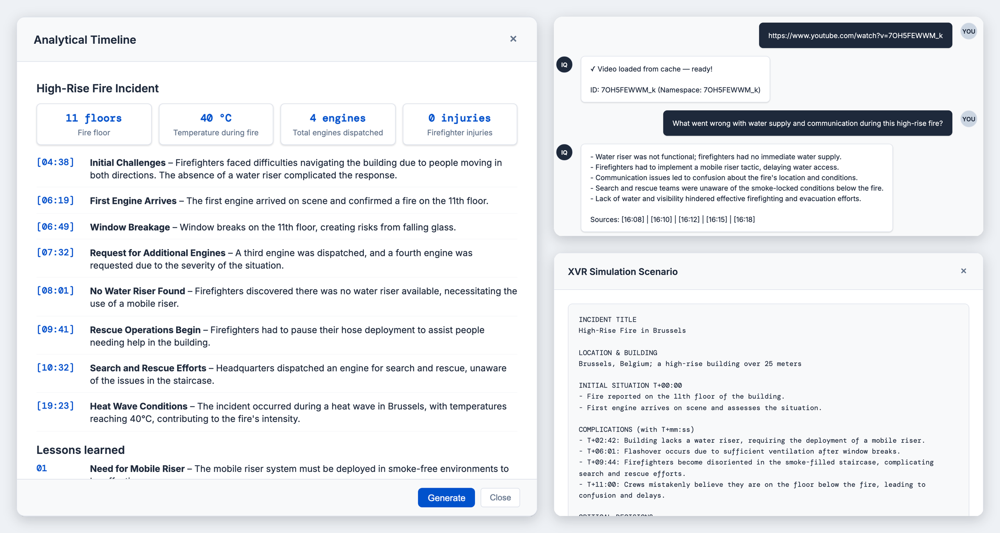

# IncidentIQ — Incident Intelligence from Video

**Turns incident training videos into searchable knowledge, debrief documents and simulation scenarios for emergency services.**


[](https://github.com/DomienDarmontAntwerpen/IncidentIQ/actions/workflows/tests.yml)

> **In short:** fire services learn a lot from incident videos, but finding the right moment or turning a video into training material takes hours. With IncidentIQ you paste a YouTube link and get a chat assistant that knows the video, a one-page key-concepts PDF, a visual incident timeline, and a ready-to-use brief for an XVR training simulation. All of it can be emailed to the team in one click.
>
> Final project for the **Ironhack AI Engineering Bootcamp (2026)**.



---

## What it does

- **Chat with a video**: ask any question about the incident and get answers grounded in the transcript.
- **Key Concepts PDF**: a branded one-page cheat sheet with key points and AI recommendations.
- **Visual timeline**: notification → arrival → problems → solutions → end.
- **XVR scenario**: a simulation brief that XVR (virtual reality training) operators can use directly.
- **Send to team**: email any generated document via Gmail.
- **Domain-agnostic**: built for fire services, but one config change adapts it to police, EMS or any organisation that learns from video.

## How it works

```
YouTube URL
    │
    ▼
Pinecone cache check ──► already indexed? skip download
    │ new video
    ▼
YouTube Transcript API → chunking (500 / 50 overlap) → OpenAI embeddings
    │
    ▼
Pinecone index (1536 dims, cosine, one namespace per video)
    │
    ▼
LangGraph agent with memory ◄──► tools
    │                             ├── search_video_knowledge  (multi-query RAG)
    │                             ├── generate_visual_summary
    │                             ├── generate_xvr_scenario
    │                             └── send_gmail
    ▼
Flask web app
```

The agent rewrites each question into several search queries (multi-query retrieval) for better recall, then decides which tool to use. Traces are logged to LangSmith.

## Results

| Metric | Score |
|---|---|
| RAGAS Faithfulness | 0.795 |
| RAGAS Context Recall | 0.750 |
| RAGAS Answer Relevancy | 0.555 |
| ROUGE-1 | 0.382 |

The full evaluation is in [notebooks/05_evaluation.ipynb](notebooks/05_evaluation.ipynb).

## Tech stack

| Layer | Technology |
|---|---|
| LLM | GPT-4o-mini |
| Embeddings | text-embedding-3-small |
| Vector database | Pinecone |
| Agent | LangGraph (tools + memory) |
| RAG | LangChain, multi-query retrieval |
| Observability | LangSmith |
| Web app | Flask + HTML/JS |
| Documents | ReportLab (PDF), Gmail API |
| Evaluation | RAGAS, ROUGE |

## Getting started

### Prerequisites
- Python 3.11
- API keys for OpenAI and Pinecone (LangSmith is optional)

### Installation
```bash
git clone https://github.com/DomienDarmontAntwerpen/IncidentIQ.git
cd IncidentIQ
python3 -m venv .venv
source .venv/bin/activate
pip install -r requirements.txt
```

### Configuration
```bash
cp .env.example .env
```
Fill in `OPENAI_API_KEY` and `PINECONE_API_KEY`. Email sending is optional: to enable it, place your own Google OAuth `credentials.json` in the project root. A browser window opens on first use.

### Run
```bash
python src/app.py
```
Open http://localhost:5000 and paste a YouTube URL.

## Running the tests
```bash
pytest
```
Unit tests for URL parsing and transcript cleaning. The RAG quality itself is measured in the evaluation notebook (see Results).

## Notebooks

The notebooks build up the system step by step:

| Notebook | Content |
|---|---|
| [01_transcript_pipeline](notebooks/01_transcript_pipeline.ipynb) | YouTube fetch, Pinecone cache, chunking |
| [02_rag_chain](notebooks/02_rag_chain.ipynb) | Query rewriting, multi-query retrieval |
| [03_agent_tools](notebooks/03_agent_tools.ipynb) | The agent tools, with quality tests |
| [04_langgraph_agent](notebooks/04_langgraph_agent.ipynb) | LangGraph agent with memory |
| [05_evaluation](notebooks/05_evaluation.ipynb) | RAGAS, ROUGE and BLEU evaluation |

## Project structure
```
IncidentIQ/
├── src/
│   └── app.py          # Flask app, LangGraph agent, tools, PDF + Gmail
├── templates/
│   └── index.html      # Web interface
├── notebooks/          # Step-by-step development and evaluation
├── tests/              # pytest unit tests
├── docs/images/        # Screenshots
├── requirements.txt
└── .env.example
```

## Status & next steps
Completed bootcamp project, working end to end. Possible next steps: support for uploaded video and audio files (not only YouTube), and multilingual transcripts.

## Author
**Domien Darmont**, AI Engineer, Antwerp, Belgium  
GitHub: [@DomienDarmontAntwerpen](https://github.com/DomienDarmontAntwerpen)  
LinkedIn: [Domien Darmont](https://www.linkedin.com/in/domien-darmont-b53b7640b/)

A live demo, the project presentation or answers to any questions are available on request.

## License
© 2026 Domien Darmont. All rights reserved.

The source code of this project is published for viewing and evaluation only. No permission is granted to copy, modify, distribute or use it, in whole or in part, without prior written consent from the author.
